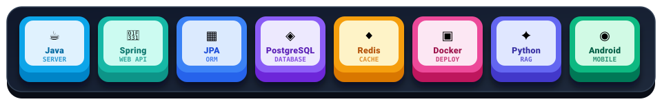
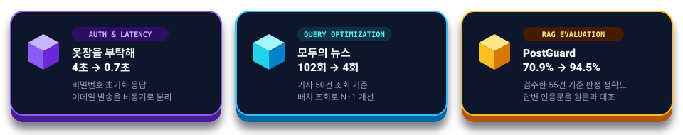
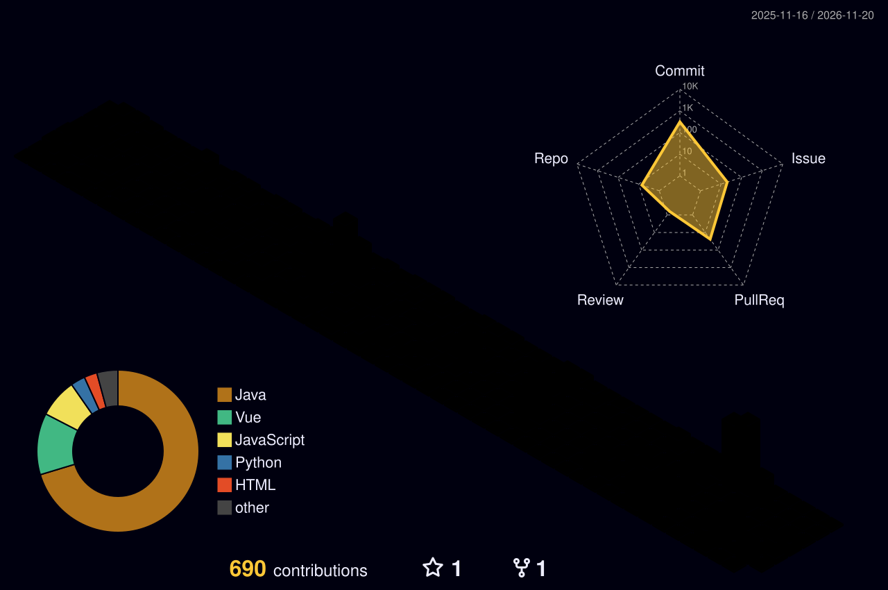

<strong>Measure. Design. Improve.</strong>

 

직접 겪은 불편을 서비스로 만들며, 선택한 구조의 한계도 기록합니다.

  

---

## 👋 소개

주로 Java와 Spring Boot로 서버를 개발해 왔습니다.
백엔드 개발에서 시작해 풀스택, AI 엔지니어링 등으로 확장하고 있습니다.

- **측정** — 개선 전후의 쿼리 수와 실행 시간을 확인했습니다. 수치로 대답하는 개발자가 되겠습니다.
- **설계** — 선택한 방식의 장점과 한계를 함께 검토합니다. 트레이드 오프를 이해하는 개발자가 되겠습니다.
- **구현** — 사용자 문제를 기능으로 만들고 실제 환경에서 검증합니다.

주식회사 인톡 개발 인턴 경험 · 2025.12 ~ 2026.03

## 🎹 기술

  

| 분야 | 사용 기술 |
|:---|:---|
| 백엔드 | Java,, Spring Boot, Spring Security, JPA, Querydsl |
| 데이터 | PostgreSQL, MySQL, Redis |
| 배포·운영 | AWS ECS, RDS, Docker, GitHub Actions |
| 그 외 | Python, React, JSP, HTML, CSS |

## 🚀 주요 프로젝트

  

| 프로젝트 | 맡은 일 | 확인한 결과 |
|:---|:---|:---|
| [옷장을 부탁해](https://github.com/gitSoyoungLee/otboo) | 인증·인가, 소셜 로그인, 프로필 | 비밀번호 초기화 응답 **4초 → 0.7초** |
| [모두의 뉴스](https://github.com/gitSoyoungLee/monew) | 페이지네이션, 조회 성능, 모니터링 | 기사 50건 조회 쿼리 **102회 → 4회** |
| [광고 성과 대시보드](https://github.com/gitSoyoungLee/ad_dashboard) | 백엔드·프론트엔드 구현 | 광고 지표 조회와 AI 분석 기능 |
| [PostGuard](https://github.com/gitSoyoungLee/post-rag-chatbot) | 규정 수집, RAG 흐름, 근거 검증 | 55건 검수 기준 정확도 **70.9% → 94.5%** |
| [RunBeat](https://github.com/gitSoyoungLee/RunBeat) | 안드로이드 러닝 기록 | 실기기 피드백을 반영하며 개발 중 |

<strong>프로젝트별 문제 해결 과정 보기</strong>

### 👕 옷장을 부탁해 &nbsp; 날씨 기반 의상 추천 플랫폼 | 4인 팀 | 2025.06 ~ 07

     

> **담당**: Spring Security 기반 인증과 인가, JWT와 OAuth2(구글, 카카오) 로그인, 프로필 관리

| 문제 | 선택과 이유 | 결과 |
|:---|:---|:---|
| 로그아웃한 JWT가 만료 전까지 재사용될 수 있음 | 인증이 필요한 모든 요청에서 조회하므로 DB 대신 **ConcurrentHashMap** 적용. 이후 서버 재시작 시 소실, 서버 간 공유 불가라는 한계 때문에 **Redis + TTL**로 전환 | 로그아웃 토큰 차단, 만료 토큰 자동 삭제 |
| 비밀번호 초기화 API가 이메일 발송을 기다려 응답이 느림 | 외부 I/O인 이메일 발송을 **비동기**로 분리 | 응답 시간 **4s → 0.7s** (약 80% 단축) |
| 업로드 이미지가 커서 저장 공간 부담 | 저장 전에 이미지를 **리사이즈** | 용량 **1.7MB → 7KB** (90% 이상 절감) |
| 배포 환경에서만 OAuth2 `redirect_uri_mismatch` 발생 | 로드밸런서의 TLS 종료로 스킴이 HTTP로 추론되는 원인을 찾아, 리디렉션 URI를 **환경 변수로 명시** | 모든 환경에서 소셜 로그인 정상 동작 |

 

### 📰 모두의 뉴스 &nbsp; 사용자 관심사 기반 뉴스 모아보기 | 5인 팀 | 2025.04 ~ 05

    

> **담당**: 페이지네이션 API, 알림 도메인 설계, 모니터링 환경 구성

| 문제 | 선택과 이유 | 결과 |
|:---|:---|:---|
| 로그만으로는 쿼리 개선 효과를 확신할 수 없음 | **Spring AOP**로 요청마다 쿼리 횟수와 실행 시간을 집계하는 측정 도구를 직접 구현 | 개선 전후를 수치로 비교하고, N+1이 있는 다른 API까지 찾아냄 |
| 기사 목록에서 댓글 수와 조회 여부를 기사마다 조회하는 **N+1** | 조회한 기사 ID를 모아 **IN 절로 일괄 조회**한 뒤 애플리케이션에서 매핑 | 기사 50건 기준 쿼리 **102회 → 4회**, 쿼리 실행 시간 합계 **66ms → 26ms** |
| 모든 도메인에 일관된 목록 조회 필요 | **Querydsl** 기반 커서 페이지네이션 구현 | 도메인 전체에 같은 방식 적용 |
| 운영 상태를 확인할 방법이 없음 | **Spring Actuator**와 **Spring Boot Admin**으로 모니터링 구성 | 애플리케이션과 배치 작업 상태 확인 가능 |

 

### 📊 광고 성과 대시보드 &nbsp; 인턴 기간 개발 | 개인 | 2025.12 ~ 2026.03

    

- 광고 성과 지표를 한 화면에서 확인하고, Gemini API로 성과 분석을 제공하는 대시보드
- [Backend](https://github.com/gitSoyoungLee/ad_dashboard) &nbsp;|&nbsp; [Frontend](https://github.com/gitSoyoungLee/ad_dashboard_FE)

 

### 📮 PostGuard &nbsp; 국제우편 규정을 근거와 함께 알려주는 멀티턴 RAG | 개인 | 2026.11

   

> **배경**: 해외로 편지와 선물을 보낼 때마다 나라별 금지품목을 여러 규정 페이지에서 직접 찾아야 했습니다.

- **231개국** 발송조건과 국제우편 법령, 고시를 직접 수집해 근거로 사용
- 처리 경로가 명확한 질문이라 자유형 에이전트 대신 **필요한 단계만 실행하는 LangGraph 워크플로**로 설계
- 중량, 서비스 조건, 요금처럼 틀리면 안 되는 값은 **코드로 계산**하고, LLM은 자연어 규정 해석만 담당
- 답변의 인용문이 실제 원문에 있는지 **코드로 검증**해 근거 없는 판정을 걸러냄
- 직접 검수한 정답 55건 기준 판정 정확도 **70.9% → 94.5%**

 

### 🏃 RunBeat &nbsp; 초보 러너를 위한 안드로이드 러닝 앱 | 개인 | 2026.10 ~ 개발 중

  

- 인터벌 코스 편집, 케이던스 메트로놈, 1km 구간 음성 안내, 자동 일시정지
- 화면이 꺼져도 기록이 이어지도록 **Foreground Service**에서 GPS, 걸음 센서, 타이머를 관리
- 실기기 테스트에서 찾은 문제를 **버전별로 원인과 해결까지 기록**하며 개선 중

## 📈 GitHub 활동

<!-- 

   -->

<h2>🌱 3D Contribution Grass &amp; Telemetry</h2>
  

    

  

    
    
  

  

    
  

   
  

<a href="https://github.com/gitSoyoungLee#contribution-activity">GitHub 기여 내역 보기 →</a>

테마 및 그래픽 출처 · <a href="https://github.com/strongsun806/celestial-github-profile">Celestial GitHub Profile</a> · <a href="./assets/CELESTIAL-LICENSE.txt">MIT 라이선스</a>

